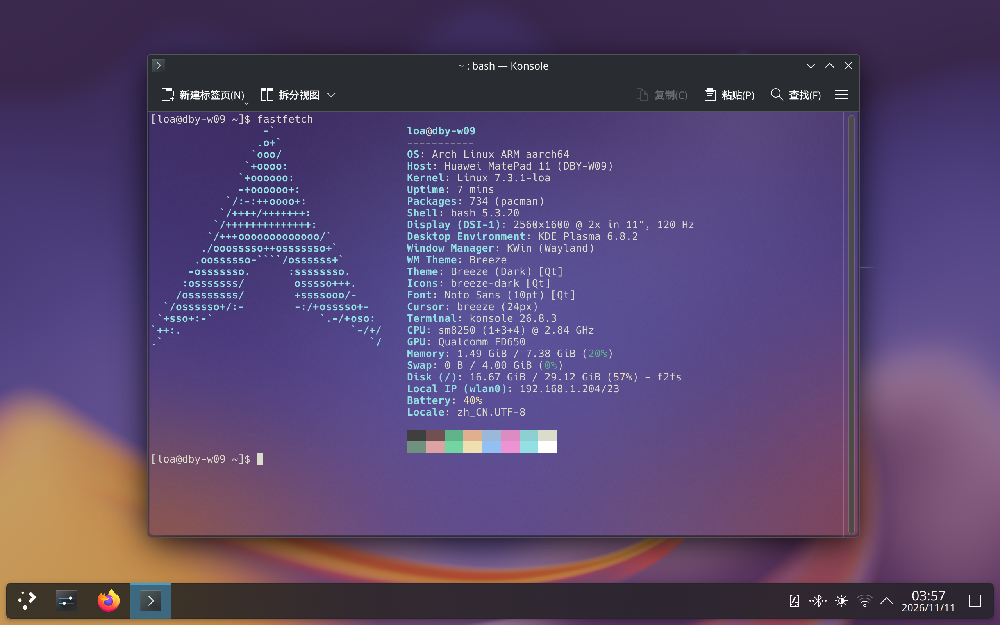

# Linux on ARM: 华为 MatePad 11 2021（DBY-W09）

在华为 MatePad 11 2021（`DBY-W09`，Qualcomm SM8250）上运行主线 Linux 的
发布仓库。

以 U-Boot、Arch Linux ARM 与 KDE Plasma 为例。

U-Boot 写入 `recovery` 分区，Linux 从 microSD 启动，HarmonyOS
保留正常启动能力。



## 支持情况

| 功能 | 状态 | 说明 |
|:--|:--|:--|
| U-Boot 与双系统菜单 | 可用 | 启动 Linux、HarmonyOS、fastboot 与复位 |
| 显示 | 可用 | 双 DSI，1600 x 2560，30 / 60 / 120 Hz |
| 触摸 | 可用 | 五点坐标、双指、手掌抑制、开关屏恢复 |
| 背光 | 可用 | RT8555，10 位亮度 |
| 电池与充电 | 可用 | PM8150B，容量、电压、电流、温度 |
| 电源模式 | 可用 | power-profiles-daemon 的 `qcom` 驱动 |
| 按键 | 可用 | 短按开关屏、2.5 秒离开对话框、7 秒强制重启、组合键 |
| WiFi | 可用 | QCA6391，ath11k，NetworkManager |
| 蓝牙 | 可用 | QCA6391，磁吸键盘与 M-Pencil 3 |
| GPU | 可用 | Adreno 650，Plasma 使用 freedreno 渲染 |
| 传感器 | 可用 | 加速度计、环境光、磁力计、指南针 |
| 自动旋转与自动亮度 | 可用 | KWin 读取 iio-sensor-proxy |
| 平板设置 | 可用 | 启动器入口与系统设置内嵌 KCM |
| 环境色温 | 可用 | libssc CCT 补丁、会话 D-Bus 服务、KWin 效果 |
| 震动 | 可用 | ERM 马达，FF_RUMBLE |
| 触控笔 | 基本可用 | 面板坐标与蓝牙压力合并，压感与橡皮 |
| 挂起到内存 | 可用 | PSCI `deep` 状态，RTC 闹钟唤醒 |
| 睡眠 | 实验 | 镜像保存与读取可用，启动期恢复待修复 |
| 音频、摄像头、视频编解码、NPU、快充 | 计划中 | 见 [支持情况](docs/status.md) |

自动旋转、自动亮度、环境色温、平板设置、电源模式与附件联动属于可选
组件，按需安装；其余功能随基础系统提供。

## 仓库结构

```
docs/            操作手册、支持情况、故障排查与固件说明
kernel/          内核补丁、defconfig 与固件放置说明
uboot/           U-Boot 补丁与 defconfig
rootfs/          部署到 SD 根文件系统的配置与服务
tools/           主机侧脚本、设备侧程序与上游补丁
scripts/         构建、打包与安装脚本
gallery/         实机截图
```

## 快速开始

```bash
scripts/fetch-sources.sh
scripts/build-uboot.sh
scripts/build-kernel.sh
scripts/pack-fit.sh
scripts/pack-recovery.sh dumps/recovery.img
sudo scripts/install-rootfs.sh --root /mnt/loa-root --user <桌面用户名> \
  --firmware firmware-root
```

完整流程从备份核对开始，设备默认已完成解锁，见
[操作全流程](docs/install.md)。
固件来源见 [固件清单](docs/firmware.md)，已知限制见
[支持情况](docs/status.md) 与 [故障排查](docs/troubleshooting.md)。

## 构建依赖

主机需要：

- `aarch64-linux-gnu-` 交叉工具链、`make`、`bc`、`bison`、`flex`
- `mkimage`（`uboot-tools`）、`dtc`
- Python 3
- 构建 U-Boot 需要 `swig`、`openssl` 开发包与 `python-setuptools`
- 构建设备侧程序需要 `aarch64-linux-gnu-gcc`

镜像打包使用仓库内的 AOSP `mkbootimg` 与 `avbtool`，主机无需安装对应包。

## 固件

内核把触摸固件与 ath11k 校准数据编入镜像。这些文件来自设备自身的
vendor 分区，仓库以清单与校验值的形式记录来源，见
[docs/firmware.md](docs/firmware.md)。

## 参与贡献

欢迎提交 issue 与 PR。测试报告、文档修正、脚本改进与驱动补丁都有帮助；
缺少设备时，文档、脚本与代码审查同样可以参与。具体约定见
[贡献指南](CONTRIBUTING.md)。

## 许可证

- 本项目原创代码、脚本、文档与实机截图采用 `GPL-3.0-or-later`，全文见
  根目录 `LICENSE`。
- 内核与 U-Boot 派生文件沿用上游许可证：内核实现补丁为 `GPL-2.0-only`，
  U-Boot 实现补丁为 `GPL-2.0-or-later`，新增驱动的 C 源文件为
  `GPL-2.0-only`，Kconfig 条目与绑定文档为
  `GPL-2.0-only OR BSD-2-Clause`，设备树为 `BSD-3-Clause`。
- `kernel/defconfig` 为 `GPL-2.0-only`；`uboot/` 下的 defconfig 与环境
  文件为 `GPL-2.0-or-later`。
- `tools/upstream/` 中的补丁沿用上游许可证：`bluez/` 为
  `GPL-2.0-or-later`，`hexagonrpc/`、`libssc/` 与
  `power-profiles-daemon/` 为 `GPL-3.0-or-later`。
- `tools/vendor/` 中的 AOSP 工具沿用 Apache-2.0、MIT 与 BSD-3-Clause。

其余许可证全文位于 `LICENSES/`。

## 致谢

本项目建立在 Linux 内核、U-Boot、linux-firmware、postmarketOS、
linux-msm 社区与小米平板 5（`elish`）主线适配的工作之上。传感器与 SDSP
通信使用 linux-msm 的 hexagonrpc。桌面与渲染来自 Arch Linux ARM、
KDE Plasma 与 freedreno（Mesa）。

感谢 BlueZ、libssc 与 power-profiles-daemon 的维护者，仓库为它们附带
补丁。

版本：v0.0.1

记录时间：2026-11-10 23:57 +8
